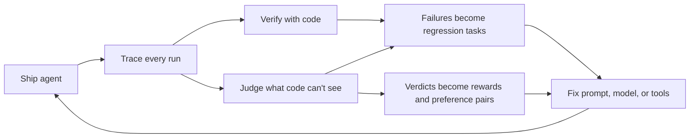

# Blueprint: a data flywheel for your agent

Repo: https://github.com/akaysh/agent-data-flywheel (everything from the workshop, runnable offline)

## 1. Build the harness first
- One task = a customer message, hidden facts, fake data, and a verifier. We use the Harbor task format.
- A simulated customer plays the persona. Mock tools serve fixed data and log every call.
- If you can't replay a conversation the same way twice, you can't measure anything. Cache the LLM calls.

## 2. Code checks for what code can check
Refund limits, which tools were called, whether a number leaked. Deterministic, free, never flaky.

## 3. Judges for the rest
Use an LLM judge only for what code can't see: honesty about what was done, tone, whether every issue was handled.

- Binary pass/fail per criterion. No 1-10 scales.
- One criterion per judge call. Never bundle.
- Every criterion has a precise definition plus a pass and a fail example.
- The judge quotes evidence before it gives a verdict.
- "na" is a real answer.
- Never use a judge for something code can check.
- No rubric is trusted until you measure kappa against expert labels. Aim for 0.7 or higher, and expect to rewrite definitions to get there.

## 4. Every failure becomes a regression task. Every verdict becomes a label.
- Failed traces turn into new eval tasks with the same fixtures and checks.
- Judge verdicts become rewards. A pass and a fail on the same prompt become a preference pair (TRL DPO format).
- You can stop at data that is ready to train on. Fine-tuning is optional.

## 5. Rerun on every change
Prompt, model, or tool change: rerun everything, including the regression tasks. In our demo a prompt fix alone did not fix the small model. The tasks told us.

## Try it
1. Open `workshop.ipynb` in Colab. It runs offline by default.
2. Swap in your own agent: replace `agent/` and the scenarios in `scenarios/scenarios.yaml`.
3. Write five scenarios from your real failures. Run the harness. Then add a judge.
